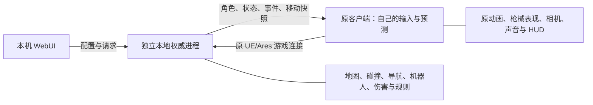

# 本地原生服务器研究

运行进展：独立宿主与原客户端的 IP 原生连接、DefaultPawn/PlayerState 复制及服务器 AI 持续运动同步已通过。可重复入口、验证范围和限制见 [本地原生网络样机](LOCAL_SERVER_PROOF.md)。真实 ShooterCharacter、枪械和输入确认/校正仍待迁移。

以下保留前一轮静态研究。目标是让原客户端通过真实游戏连接接入独立的本地权威进程，由该进程负责机器人、世界模拟、装备、伤害、计分和重生；客户端保留自己的输入预测、相机、动画、声音、皮肤和 HUD。该轮没有启动服务器或进行游戏连接。

目标程序固定为 SHA-256 `147763350504d241ee20b77607d04bc85cebfedb1d8bc2f32473ca93bf8fe92f`。所有地址仅对应这一份程序。引擎公开文档用于解释职责划分，不能证明当前 Riot 定制版本与某个公开 UE 版本在二进制或网络协议上兼容。

## 当前结论

1. 原网络驱动和客户端远程更新代码仍保留，有继续研究原生本地连接的基础。
2. 常规地图加载中的 `?listen` 路径缺少实际托管动作；底层驱动仍有实质的监听初始化。后续样机已通过隔离的原生回环监听与入场验证，证明可以补齐托管装配；完整游戏权威仍是另一层工作。
3. 已确认的服务器输入接收、重生和装备创建入口包含空实现。让客户端连上一个端口以后，还需要补齐权威游戏逻辑。
4. 当前工作目录没有匹配的完整服务器程序、游戏服务器源码和构建目标。现有客户端资源不能单独编译出缺失的游戏服务器。

前序范围和证据见 [原托管可行性审计](../work/original-local-server-feasibility/report.md)。本轮扩展审计与验收门槛见 [研究索引](../reports/local-server-research.json)。

## 本轮新增的原生证据

以下是原文件的静态指令和反射布局证据，均未执行。

| 环节 | 原程序中的实质入口 | 证实的范围 |
| --- | --- | --- |
| 网络驱动工厂 | `PendingNetGame 0x4857E60 → 0x4C2B940` | 原内部工厂能读取 driver 定义、加载并构造 UNetDriver，再加入 WorldContext 活动驱动记录；尚未确认所有宿主侧包装和可达条件 |
| 客户端初始化 | `PendingNetGame → driver.v308 = 0x5118500` | 保留 InitConnect 行为代码；实际回环握手和入场未验证 |
| 监听初始化 | `driver.v310 = 0x5118750` | 保留以服务端参数初始化、创建 connectionless handler、取得 socket 端口及成功返回的代码；常规 LoadMap 的 `?listen` 路径仍缺托管动作 |
| 远程人物接收 | `AresPlayerController.ClientReceiveRemoteCharacterUpdates*` 三个 RPC | 三个真实 native 实现交给原 RemoteCharacterUpdateManager；不是空 wrapper 结论 |
| 远程解码 | `0x7866400 → NetGUIDCache 0x4785360 → Role1 Pawn → 0x7171C00` | 按原 NetGUID 解析已存在人物，使用真实 FBitReader 处理原组件流，包括 Movement、InputState 和 PDD；错误处理仍在 |
| 原组件流 NetSerialize | `0x6662590 → 0x7170F50` | 原组件数据流的序列化入口保留；没有因此证明全部服务器快照生产逻辑齐全 |
| 权威输入缺口 | `ServerReceiveNetworkStream → Pawn.vA58 = 0x18A3A00` | 该版本的目标实现是 `ret`，不能自行执行远程命令的权威模拟 |

详细接收链见 [客户端静态审计](../work/local-server-architecture/client-network/report.md)，驱动工厂与宿主能力见 [服务器能力审计](../work/local-server-architecture/server-capability/report.md)。反射参数大小只描述本地调用布局，不等同于 UDP 报文长度。

远程人物的 Role1 解码已确认有实质代码。本地自主玩家 Role2 的输入确认、校正与回放尚未完整串通；已识别的 autonomous 尾部流属于 DebugDataStream，不能用它证明正常预测链可用。服务器还需要生产正确的状态流，角色展示解码器也不能替代服务器命令接收与模拟。

## 建议优先验证的结构

优先研究复用同版本程序的引擎、原地图碰撞、原生类和网络驱动，作为独立的权威宿主；在宿主一侧补齐缺失入口，让渲染客户端通过原网络连接接入。这是待验证的方案，目前没有证明该客户端程序能充当完整服务器。

在正确归属下，服务器持有各人物的权威状态；当前客户端仅拥有自己对应的本地玩家和控制器，其他人物走远程表现路径。UE 的连接归属会影响复制范围和 RPC 目标，原生 PlayerController 默认只复制给自己的客户端。[Epic：Actor Owner and Owning Connection](https://dev.epicgames.com/documentation/en-us/unreal-engine/actor-owner-and-owning-connection-in-unreal-engine)

原本地输入仍需要预测与服务器校正，不能等待服务器返回后才响应每次移动。Riot 对原网络架构的说明也将本地预测、服务器权威和远程缓冲分别处理。[Riot：Peeking into VALORANT's Netcode](https://www.riotgames.com/en/news/peeking-valorants-netcode)

## 当前模块如何迁移

| 现有职责 | 目标位置 | 需要解决的实际依赖 |
| --- | --- | --- |
| 模式、人数、路线、机器人水平设置 | 权威进程 | 配置版本、校验和确认；WebUI 继续作为控制台 |
| 机器人决策、瞄准意图、拉出路线 | 权威进程 | 导航、可见性和碰撞需要服务器世界 |
| 移动与人物朝向 | 服务器模拟；本地玩家做预测 | 原输入流、固定时步、确认/校正、远程快照 |
| 弹药、命中、伤害、死亡、出生 | 权威进程 | 原物理与骨体查询、生命状态、装备/实体生命周期 |
| 总击杀、短时连杀、结束条件 | 权威进程 | 两种计数独立，事件只能提交一次 |
| 自己的控制器、鼠标、设置、HUD、监听器 | 渲染客户端 | 原拥有连接与 LocalPlayer 对应关系 |
| 皮肤模型、动画、音效和特效播放 | 渲染客户端 | 权威装备/事件标识与原表现订阅者保持一致 |

当前代码依赖清单及原文件哈希见 [current-ownership.json](../work/local-server-architecture/current-ownership.json)。例如 `training_combat_runtime::Process` 直接使用原骨体和世界遮挡查询，再调用原伤害响应；它无法带着当前进程中的对象指针直接搬到普通外部服务。服务器需要真实世界执行环境，或经过验证的独立物理与导航实现。

## 路线比较

| 路线 | 当前判断 | 主要工作 |
| --- | --- | --- |
| 匹配版本的完整原服务器程序/源码 | 当前材料未提供 | 核对版本、原生类、资源与纯本地会话生命周期 |
| 同版本程序作为引擎宿主，服务器侧补齐缺口 | 优先做有限验证 | 引擎托管、客户端 join、原对象复制，再处理空权威入口；尚未证明能完成 |
| 独立重写 UE/Ares 兼容服务器 | 可研究，工作范围大 | 游戏会话、通道、PackageMap/NetGUID、类与 RPC 布局、自定义输入/状态流、物理和预测一致性 |
| 自定义协议加客户端适配层 | 保留为后备路线 | 仍需要明确的客户端集成与原生表现边界，不能等同于原生客户端已连接成功 |

仅将计分或机器人参数移到另一个进程，仍由渲染客户端本地装配并模拟全部人物，会保留很多当前归属问题。真正的迁移必须覆盖世界执行权和实体生命周期。原生连接也不能保证资源、UI 或动画代码自身的所有问题自动消失。

公开 UE 的专用服务器通常由项目源码和独立 Server 构建目标生成；该说明不能替代此项目缺少的游戏服务器实现。[Epic：Setting Up Dedicated Servers](https://dev.epicgames.com/documentation/en-us/unreal-engine/setting-up-dedicated-servers?application_version=4.27)

## 分阶段验证门槛

先使用斗牛一、一名真人和一个远程人物，按下列门槛推进；通过后再扩展乱斗和全部外观。

1. **宿主与连接**：独立宿主拥有原 GameNetDriver，实际仅绑定回环地址；客户端通过原 InitConnect 和游戏握手到达可识别的连接状态。日志中的“开始监听”和 HTTP 接口正常均不足以通过。
2. **原生入场与实体复制**：客户端完成地图与玩家连接流程，得到原 PlayerController、PlayerState 和 Pawn；一个远程人物经原对象/组件复制创建。客户端不再通过现有 NPC 工厂把它装配为本地玩家。
3. **移动**：输入由服务器接收并在固定时步中执行；原客户端处理自己的预测与确认/校正，远程人物使用原更新和插值。核对位置、朝向、蹲跳、移动状态以及旧数据处理。
4. **枪械与生命周期**：服务器负责装备、弹药、射击顺序、命中和生命状态，原客户端接收表现和结果；真实死亡后只创建新一代实体，旧枪、事件和音效不重复提交。
5. **归属和扩展**：客户端始终只有自己的 LocalPlayer、UI 及音频监听器；验证菜单、购买、人物朝向、声音距离，再接入乱斗计分、短时连杀、模式与地图切换。

每一步都分别保存服务器与客户端 PID、目标哈希、有效绑定地址、连接状态、实体身份、时步/输入确认、状态与事件读回。两个进程使用独立日志与诊断目录，避免当前全局诊断文件互相覆盖。断开、重连、旧出生代次和重复事件均需要明确处理。

## 保留的未知项

- 实际传输握手、网络兼容版本、包处理链和纯本地会话初始化是否能够在现有程序内完整工作。
- 同版本程序能否建立可用的权威世界，以及裁剪的 GameMode、入场与组件初始化还有多少缺口。
- 原客户端的自主预测确认和远程人物更新，对服务器快照字段、顺序及时步的完整要求。
- 无渲染运行及资源占用是否可接受；`-server`、`-nullrhi` 等参数尚未实测，不能作为既有能力。
- 哪些缺口能集中在服务器适配模块中补齐，哪些仍需要少量客户端本地会话/引导集成。

所有研究文件、缓存与未来验证输出保留在 F 盘。继续复用只读资源，不为服务器复制整套资源；当前可玩版本保留为回归对照。本轮没有执行账号登录、启动服务器或操作现有游戏。
